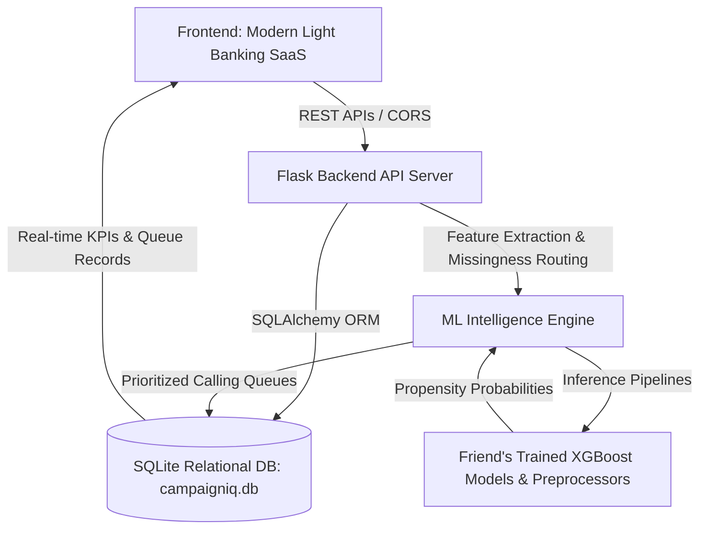
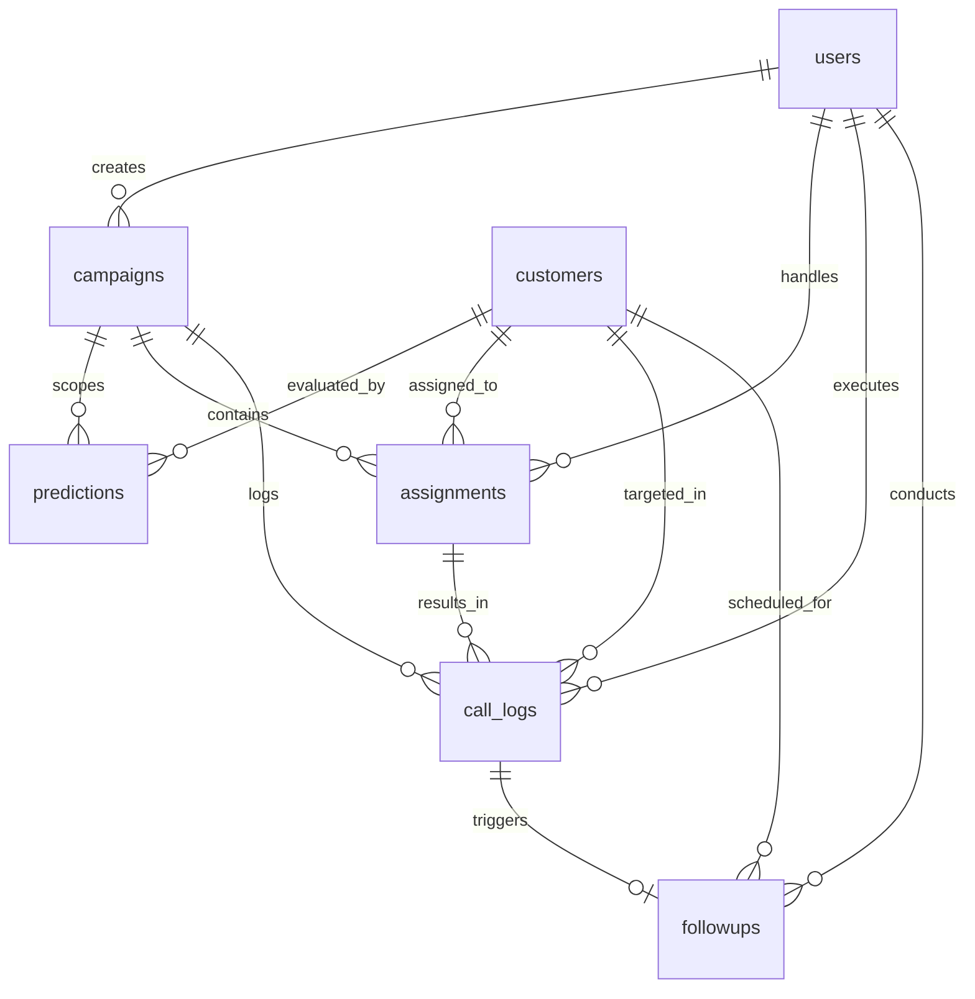

# CampaignIQ — Banking Call Center Intelligence System (PS-8)

An enterprise-grade, ML-powered banking call center operations platform designed for **Team Leaders** and **Calling Agents** to prioritize leads, manage workload distribution, track telemarketing calls, schedule follow-ups, and monitor campaign efficiency using real database records.

---

## 1. System Architecture



---

## 2. Project Stakeholders & Workflow

This platform is purpose-built for the **Banking Call Center Team** with two role-based workspaces:

### 1. Call Center Team Leader
- **Control Center Dashboard:** Real-time KPI cards (Total Pool, Calls Completed, Term Deposit Subscriptions, Conversion Rate, Overdue Callbacks).
- **Interactive Visualizations:** Chart.js donut chart for call dispositions and agent-wise workload vs conversion comparison.
- **"Needs Attention" Queue:** Proactive bottleneck alerts for overdue customer callbacks and unassigned high-priority leads.
- **Campaign Lifecycle Management:** Create telemarketing campaigns, set calling quotas, and trigger automated ML batch scoring.
- **Smart Workload Distribution:** Fairly allocates prioritized leads across active agents (High Priority first) with pre-assignment simulation previews.

### 2. Calling Agents
- **Agent Workspace:** Personal conversion metrics, queue throughput, and daily completed calls.
- **"Smart Next Call" Recommendation:** Evaluates pending callbacks due today first; if none, recommends the highest propensity uncontacted lead in their queue.
- **Personalized Calling Queue:** Table ordered with High Priority customers first, complete with demographics and contact history.
- **Call Disposition Modal:** Real-time `MM:SS` duration timer, disposition outcome logging (`Subscribed`, `Interested`, `Follow-up Required`, `Unreachable`, `Not Interested`), and callback scheduler.
- **Personal Call History & Follow-ups:** Audit trail of completed calls and pending callbacks.

---

## 3. Machine Learning Integration

The system integrates your friend's pre-trained XGBoost models and preprocessors without retraining:

1. **Artifacts Used (`backend/`):**
   - `campaigniq_xgboost.pkl`: Original trained XGBoost classifier.
   - `campaigniq_xgboost_preprocessor.pkl`: Serialized `ColumnTransformer` pipeline.
   - `campaigniq_xgboost_v2.pkl`: Missingness-Aware V2 XGBoost classifier.
   - `campaigniq_xgboost_v2_preprocessor.pkl`: Serialized Missingness-Aware pipeline.
2. **Target Leakage Prevention:**
   - In accordance with production telemarketing constraints, the `duration` attribute is **strictly omitted** from prediction features, as call duration is unknown prior to initiating contact.
3. **Derived Feature Engineering:**
   - `was_previously_contacted`: Computed dynamically as `(pdays != 999)`.
   - `had_previous_campaign`: Computed dynamically as `(previous > 0)`.
4. **Adaptive Missingness-Aware Routing:**
   - $\le 3$ missing optional attributes: Routes to **Original XGBoost** (Scenarios: `Complete`, `10% missing`, `25% missing`).
   - $> 3$ missing optional attributes: Dynamically routes to **Missingness-Aware V2** (Scenarios: `40% missing`, `60% missing`, `100% missing`).
5. **Operational Priority Tiers:**
   - **High Priority:** Propensity $\ge 50\%$ or $\ge$ model scenario threshold.
   - **Medium Priority:** Propensity between $20\%$ and $50\%$.
   - **Low Priority:** Propensity $< 20\%$.

---

## 4. Relational Database Schema (`campaigniq.db`)



| Table | Purpose |
| :--- | :--- |
| **`users`** | Team Leader (`leader`) and Calling Agent (`agent`) accounts with hashed passwords (`werkzeug.security`). |
| **`customers`** | 25+ UCI benchmark records (demographics, contact history, macroeconomic indicators). |
| **`campaigns`** | Campaign metadata, target quotas, and lifecycle states (`draft`, `active`, `paused`, `completed`). |
| **`predictions`** | Background ML intelligence store with probabilities, priority tiers, and scenario metadata. |
| **`assignments`** | Workload allocation linking customers to agents with unique constraints to avoid duplicate assignments. |
| **`call_logs`** | Complete audit trail of telemarketing outcomes, actual call duration in seconds, and remarks. |
| **`followups`** | Scheduled callback queue with timestamps and completion statuses (`pending`, `completed`, `overdue`). |

---

## 5. API Reference

| Method | Endpoint | Description |
| :--- | :--- | :--- |
| `GET` | `/api/health` | System health check (DB connectivity & ML model loading status). |
| `POST` | `/api/auth/login` | Role-based user authentication. |
| `GET` | `/api/agents` | Lists active agents with pending load and conversion rates. |
| `GET` | `/api/campaigns` | Lists campaigns with live priority distribution counts. |
| `POST` | `/api/campaigns` | Creates a new draft campaign. |
| `POST` | `/api/campaigns/<id>/launch` | Triggers background ML batch scoring and launches campaign. |
| `GET` | `/api/campaigns/<id>/prioritized-customers` | Returns ranked calling queue with optional priority filters. |
| `POST` | `/api/assignments/preview` | Previews simulated workload distribution across agents. |
| `POST` | `/api/assignments/distribute` | Commits workload distribution to the database. |
| `GET` | `/api/agent/queue` | Returns personalized calling queue for the logged-in agent. |
| `GET` | `/api/agent/next-call` | "Smart Next Call" recommendation algorithm. |
| `POST` | `/api/calls/log` | Records call outcome, notes, duration, and schedules follow-ups. |
| `GET` | `/api/followups` | Lists pending and overdue follow-up callbacks. |
| `POST` | `/api/followups/<id>/complete` | Resolves and marks a follow-up as completed. |
| `GET` | `/api/analytics/leader-dashboard` | Dynamic database KPIs and outcome distributions. |
| `GET` | `/api/analytics/agent-dashboard` | Personal metrics and recent calling history for agents. |

---

## 6. Installation & Quick Start

### 1. Requirements
- Python 3.10+
- Dependencies listed in `backend/requirements.txt`:
  ```bash
  pip install -r backend/requirements.txt
  ```

### 2. Seed Database
Initialize all 7 relational tables and populate default users and benchmark bank customers:
```bash
python backend/seed_data.py
```
*Default Credentials:*
- **Team Leader:** `username: leader` | `password: leader123` (`Vikram Malhotra`)
- **Calling Agent 1:** `username: agent1` | `password: agent123` (`Rahul Sharma`)
- **Calling Agent 2:** `username: agent2` | `password: agent123` (`Priya Patel`)
- **Calling Agent 3:** `username: agent3` | `password: agent123` (`Amit Verma`)

### 3. Run Application Server
```bash
python backend/app.py
```
Open **`http://127.0.0.1:5000`** in your browser to access the complete application.

### 4. Run Automated Test Suite
```bash
pytest tests/ -v
```
All 24 automated unit and integration tests will run and pass.

---

## 7. Demonstration Workflow

1. Open `http://127.0.0.1:5000`. You are automatically logged in as **Team Leader (Vikram Malhotra)**.
2. View the **Control Center Dashboard** displaying real-time database KPIs and Chart.js visualizations.
3. Click **"Campaigns"** in the sidebar. Click **"Launch & Prioritize"** on the active campaign. Notice that the backend pulls customers and prioritizes them in the background using your friend's trained XGBoost model without any manual form filling!
4. Navigate to **"Prioritization"** to inspect the ranked customer list (e.g. Neha Agarwal, 93.12% propensity).
5. Navigate to **"Workload Assignment"** and click **"Distribute Unassigned Customers"** -> **"Generate Workload Preview"** -> **"Commit Assignments"**. Leads are distributed evenly to active agents.
6. Click **"Switch"** in the sidebar and choose **Rahul Sharma (Agent 1)**.
7. Notice the workspace switches to the **Calling Agent Interface**. The **"Smart Next Call"** banner immediately recommends **Neha Agarwal** (Rank 1 High Priority).
8. Click **"Call Customer Now"**. The call modal opens with an active `MM:SS` timer. Select **"Subscribed"**, add remarks, and click **"Save Call Outcome"**.
9. The timer stops, the call log is saved to the database, and the queue automatically refreshes!
10. Switch back to **Team Leader** to watch the Conversion Rate and Calls Completed metrics update in real-time!
